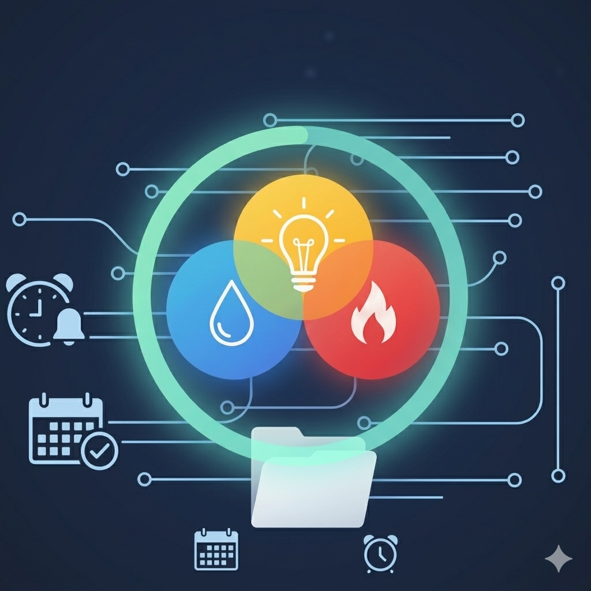

<p align="center">
  
</p>

# Bolletta Sync

Bolletta Sync is a Python-based web service designed to automate the synchronization of utility invoices from various Italian providers to Google Drive and Google Tasks. It uses Playwright for web scraping and a Google Apps Script web app to write to Google Drive and Google Tasks.

## Features

- **Multi-Provider Support**: Automatically fetch invoices from:
  - Fastweb (Fixed line)
  - Fastweb Energia (electricity and gas)
  - Eni Plenitude (with CAPSolver token solving for ReCaptcha)
  - Umbra Acque
- **Google Drive Integration**: Automatically uploads invoice PDFs to Google Drive, organized by year and provider (e.g., `bollette/2025/fastweb/...`).
- **Google Tasks Integration**: Creates tasks for invoice payment deadlines with the due date and amount.
- **REST API**: Simple FastAPI interface to trigger synchronization and check status.
- **Sync Persistence**: Saves the result of every synchronization to `data/last_sync.json` for easy auditing and status tracking.
- **Retry from the Dashboard**: When a provider fails, a **Retry failed** button on the dashboard re-runs the sync for the failed providers only, over the same date range.

## Prerequisites

- **Python 3.13** or higher.
- **[uv](https://docs.astral.sh/uv/)**: used for dependency management and running the app.
- **Google account**: The Apps Script web app in `apps_script/` deployed on the account that owns the Drive and Tasks data (see [Google Apps Script Setup](#google-apps-script-setup)). No Google Cloud project or OAuth client is required.
- **CAPSolver API Key**: Required to solve the ReCaptcha on the Eni Plenitude login page, which is done with a `ReCaptchaV2TaskProxyLess` task.

## Installation

1. **Clone the repository**:
   ```bash
   git clone <repository-url>
   cd bolletta_sync
   ```

2. **Install dependencies**:
   ```bash
   uv sync
   ```

3. **Install Playwright Browsers**:
   ```bash
   uv run playwright install chromium
   ```

## Configuration

The application uses environment variables for configuration. Create a `.env` file in the project root with the following keys:

```env
# General
CAPSOLVER_API_KEY=your_capsolver_key

# Google Apps Script web app
APPS_SCRIPT_URL=https://script.google.com/macros/s/<deployment-id>/exec
APPS_SCRIPT_SECRET=your_shared_secret

# Fastweb
FASTWEB_USERNAME=your_username
FASTWEB_PASSWORD=your_password
FASTWEB_CLIENT_CODE=code1,code2  # Comma-separated if multiple

# Fastweb Energia (electricity and gas)
FASTWEB_ENERGIA_USERNAME=your_username
FASTWEB_ENERGIA_PASSWORD=your_password
FASTWEB_ENERGIA_SUPPLY_CODE=pod_code,pdr_code  # Optional: comma-separated POD (electricity) / PDR (gas) codes

# Eni Plenitude
ENI_USERNAME=your_email
ENI_PASSWORD=your_password

# Umbra Acque
UMBRA_ACQUE_USERNAME=your_email
UMBRA_ACQUE_PASSWORD=your_password

# App Mode
DEV_MODE=false

# Security (Optional)
BASIC_AUTH_USERNAME=your_username
BASIC_AUTH_PASSWORD=your_password

# Sync (Optional)
SYNC_DAYS_OFFSET=10        # Optional: Number of days to look back (default: 10)
```

### Google Apps Script Setup

Bolletta Sync doesn't call the Google APIs directly: it sends each invoice to a Google Apps Script web app, which runs as your Google account and writes to Drive and Tasks. The script lives in `apps_script/`.

1. Go to [script.google.com](https://script.google.com/) and create a new project (e.g. *Bolletta Sync*).
2. In **Project Settings**, enable **Show "appsscript.json" manifest file in editor**.
3. Replace the content of `Code.gs` and `appsscript.json` with the files in `apps_script/`. The manifest enables the **Tasks** advanced service.
4. In **Project Settings → Script Properties**, add a property `SECRET` with a long random value (e.g. `openssl rand -hex 32`).
5. Click **Deploy → New deployment**, select type **Web app**, with *Execute as: Me* and *Who has access: Anyone*. Authorize the requested Drive and Tasks permissions.
6. Copy the web app URL (ending in `/exec`) into `APPS_SCRIPT_URL`, and the secret into `APPS_SCRIPT_SECRET`.

Requests without the right secret are rejected by the script. When you change the script, use **Deploy → Manage deployments → Edit → New version** to keep the same URL.

On startup the service pings the web app and logs a warning if it can't be reached or the secret is wrong.

#### Migrating from the Google OAuth setup

Previous versions used an OAuth client in a Google Cloud project. After deploying the script and setting the two variables above, `data/google_credentials.json` and `data/google_token.json` are no longer used and can be deleted. Files and tasks already created are detected, so they won't be duplicated.

## Usage

### Start the API Server

Run the server using FastAPI:

```bash
uv run fastapi dev bolletta_sync/main.py
```

The service will be available at `http://localhost:8000`.

### Scheduling

Bolletta Sync no longer ships a built-in scheduler. To run the synchronization on a recurring basis, use an external scheduler (e.g. a system `cron` job, a container orchestrator, or a CI pipeline) that calls the `POST /sync` endpoint.

Example crontab entry that triggers a daily sync at midnight:

```bash
0 0 * * * curl -s -u "$BASIC_AUTH_USERNAME:$BASIC_AUTH_PASSWORD" -X POST http://localhost:8000/sync -H "Content-Type: application/json" -d '{}'
```

With an empty body, all providers are synced for the last `SYNC_DAYS_OFFSET` days (defaults to 10).

### API Endpoints

If `BASIC_AUTH_USERNAME` and `BASIC_AUTH_PASSWORD` are set, all API endpoints require authentication via session cookie (browser) or HTTP Basic Auth (API clients / Swagger).

- **GET `/`**: Check API status, version, whether the Apps Script web app is configured (`apps_script_configured`), whether a sync is currently running (`sync_in_progress`), and the details of the last synchronization.
- **GET `/providers`**: List supported providers.
- **POST `/sync`**: Trigger a synchronization process in the background. Returns a 200 status code once the process has been taken over by the server, **503** if the Apps Script web app is not configured, or **409** if a sync is already running — only one sync may run at a time.

  **Request Body Example**:
  ```json
  {
    "providers": ["fastweb", "eni"],
    "start_date": "2025-01-01",
    "end_date": "2025-02-01"
  }
  ```
  *If `providers` is omitted, all providers will be synced. `start_date` defaults to `SYNC_DAYS_OFFSET` days ago (default 10), and `end_date` defaults to today.*

### Retrying a Failed Sync

When the last run reports at least one provider in error, the dashboard shows a **Retry failed** button next to the sync status. It re-runs the sync for the failed providers only, reusing the date range of the previous run, and reloads the page automatically until the sync finishes.

The report in `data/last_sync.json` is **merged** with the previous one instead of being replaced, so providers that are not part of a retry keep their last known result. Each provider entry carries its own `date`, and the top-level `start_date` / `end_date` record the range of the most recent run:

```json
{
  "date": "2025-01-10T09:15:00.000000",
  "start_date": "2024-12-31",
  "end_date": "2025-01-10",
  "status": "error",
  "results": {
    "fastweb": { "status": "success", "count": 1, "attempts": 1, "date": "2025-01-10T09:02:00.000000", "invoices": [] },
    "eni": { "status": "error", "attempts": 4, "date": "2025-01-10T09:15:00.000000", "error": "..." }
  }
}
```

## Project Structure

- `bolletta_sync/main.py`: FastAPI application and entry point.
- `bolletta_sync/sync.py`: Main logic for orchestration.
- `bolletta_sync/apps_script.py`: Client for the Apps Script web app.
- `bolletta_sync/providers/`: contains individual scrapers for each utility provider.
  - `base_provider.py`: Abstract class with shared Google Drive/Tasks logic.
- `apps_script/`: Google Apps Script web app that writes to Google Drive and Google Tasks.
- `data/`: contains the `last_sync.json` report.
